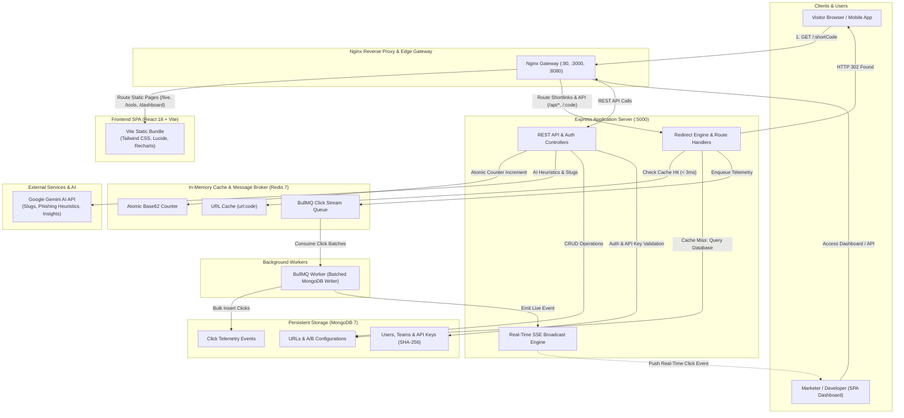
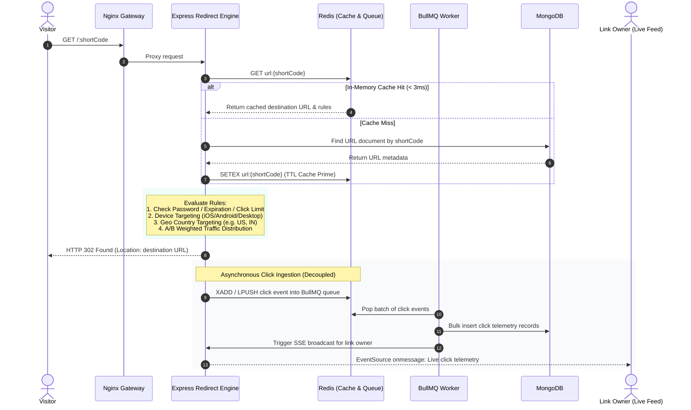
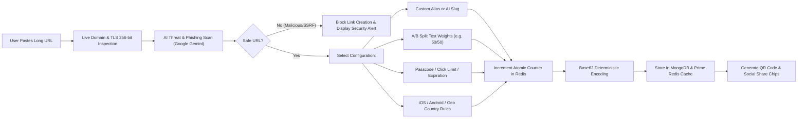

# SnipURL

SnipURL is a high-performance URL shortening, link management, and real-time telemetry platform built with Node.js, Express, React, Redis, MongoDB, and Nginx. It features sub-3ms edge redirection, Google Gemini AI link intelligence, A/B split testing, geo/device routing, self-destructing burn links, and live click streaming via Server-Sent Events (SSE).

**Designed and developed by Satyam Kumar Mishra**

---

## Architecture Overview



---

## How It Works

### 1. High-Speed Sub-3ms Redirect Flow

When a visitor clicks a short URL (e.g. `http://domain.com/abc123`), the request travels through Nginx to the Express Redirect Engine. Redis delivers in-memory cache hits in sub-3 milliseconds. Telemetry recording is completely decoupled from the redirect path via asynchronous message queues, ensuring zero latency for visitors.



---

### 2. Link Creation, AI Analysis & A/B Configuration Flow



---

## Core Capabilities

### ⚡ Redirection & Traffic Routing
- **Sub-3ms Latency**: In-memory positive caching (`url:{code}`) and negative caching (`notfound:{code}`) powered by Redis.
- **A/B Split Testing**: Randomly divide incoming clicks between original URLs and alternate landing page variants according to custom percentage weights.
- **Device Targeting**: Route iOS traffic to Apple App Store, Android visitors to Google Play Store, and desktop users to web portals.
- **Geo-Location Targeting**: Direct visitors to localized destination URLs based on ISO 3166-1 alpha-2 country codes.
- **Atomic Base62 Encoding**: Collision-free, deterministic slug generation using a high-speed counter (over 56.8 billion IDs in 6 characters).

### 🛡️ Security & Privacy
- **SSRF & Private IP Protection**: Multi-tier security layer blocks redirects to loopback addresses, AWS/cloud metadata services (`169.254.169.254`), and private subnets (`10.0.0.0/8`, `172.16.0.0/12`, `192.168.0.0/16`).
- **Passcode Protection**: Protect sensitive destinations behind bcrypt password gates.
- **One-Time Burn Links**: Links that automatically self-destruct after the first click.
- **Link Expiration & Max Click Caps**: Automatically expire links after 1 hour, 24 hours, 7 days, 30 days, or a custom click count.
- **SHA-256 API Key Storage**: Developer API keys (`snip_live_...`) are cryptographically hashed using SHA-256 at rest and masked in responses.
- **ReDoS Defense**: User search queries and custom aliases are sanitized with regex character escaping.
- **Reserved Slugs Protection**: Prevents collisions with frontend routes (`/live`, `/tools`, `/dashboard`, `/admin`).

### 📊 Real-Time Analytics & Intelligence
- **Live SSE Telemetry Stream**: Real-time click stream powered by Server-Sent Events with authenticated owner isolation.
- **Detailed Visitor Metrics**: Records hashed IP addresses, geolocated country and city, operating system, browser, and HTTP referrer.
- **Bot & Crawler Filtering**: Automatically distinguishes between human clicks and automated crawlers (Googlebot, Bingbot, Twitterbot).
- **Google Gemini AI Copilot**: Synthesizes traffic velocity, recommends audience targeting optimizations, and answers natural language questions.
- **Data Export**: Full CSV export support for single-link click streams and overall account analytics.

### 🛠️ Campaign Tools & Developer Platform
- **Bulk Shortener**: Shorten up to 100 links in a single batch via text paste or CSV upload.
- **Campaign UTM Builder**: Attach standardized Google Analytics parameters (`utm_source`, `utm_medium`, `utm_campaign`, `utm_term`, `utm_content`) with one-click presets.
- **Developer REST API**: Create and manage links programmatically using API keys or JWT bearer tokens.
- **HMAC-SHA256 Webhooks**: Receive signed JSON payload notifications whenever links are clicked or reach expiration.
- **Custom Domains & Workspaces**: Workspace collaboration and custom-domain TXT verification.

---

## Tech Stack

| Component | Technology | Role |
| :--- | :--- | :--- |
| **Frontend** | React 18, Vite, Tailwind CSS | Single Page Application (SPA), Dark/Day theme, animated interactions |
| **Icons & Charts**| Lucide React, Recharts | Telemetry area charts and UI iconography |
| **Backend API** | Node.js 20, Express 4, Mongoose 8 | REST API, redirection engine, authentication, safety heuristics |
| **Cache & Queue**| Redis 7, BullMQ | In-memory cache (< 3ms), atomic counters, asynchronous click queues |
| **Database** | MongoDB 7 | Document store for users, links, click analytics, and webhooks |
| **Gateway** | Nginx (Alpine) | Reverse proxy, prefix routing, asset caching, rate limiting |
| **AI Engine** | Google Gemini API | Phishing threat heuristics, smart slug generator, traffic synthesis |

---

## Getting Started

### Prerequisites
- [Docker Engine](https://docs.docker.com/engine/install/) & Docker Compose v2
- Node.js 20+ (for local development without Docker)

### 1. Environment Configuration

Copy the example configuration to `backend/.env`:

```bash
cp .env.example backend/.env
```

Review and configure your environment variables:

| Variable | Description | Default |
| :--- | :--- | :--- |
| `PORT` | Express backend port | `5000` |
| `BASE_URL` | Public base URL for shortlinks | `http://localhost:3000` |
| `CLIENT_URL` | Frontend origin for CORS and redirects | `http://localhost:3000` |
| `MONGO_URI` | MongoDB connection string | `mongodb://mongodb:27017/url_shortener` |
| `REDIS_URL` | Redis connection string | `redis://redis:6379` |
| `JWT_SECRET` | Secret key for signing JWT auth tokens | *High-entropy secret* |
| `GEMINI_API_KEY` | *(Optional)* Google Gemini API Key for AI features | `""` |

---

### 2. Run with Docker Compose

Start all containers in detached mode:

```bash
docker compose up -d --build
```

The stack provisions the following services:

| Container | Internal Port | Host Port | Purpose |
| :--- | :--- | :--- | :--- |
| `url_shortener_nginx` | `80` | `3000`, `8080` | Edge gateway & reverse proxy |
| `url_shortener_frontend` | `80` | Internal | Static React production build |
| `url_shortener_backend` | `5000` | `5000` | Express REST API & redirect engine |
| `url_shortener_worker` | — | Internal | BullMQ background click ingestion worker |
| `url_shortener_redis` | `6379` | `6379` | Redis caching, counters & queues |
| `url_shortener_mongodb` | `27017` | `27017` | Persistent MongoDB database |

Once the containers are up, access the application at:
- **Web Application**: [http://localhost:3000](http://localhost:3000)
- **API Health Check**: [http://localhost:3000/health](http://localhost:3000/health)

---

### 3. Local Development (Without Docker)

Install dependencies:
```bash
# Backend
cd backend
npm install

# Frontend
cd ../frontend
npm install
```

Start MongoDB and Redis locally, then run the development servers:

```bash
# Terminal 1: Backend API
cd backend
npm run dev

# Terminal 2: BullMQ Worker (optional in dev; dev backend runs embedded worker)
cd backend
npm run worker:dev

# Terminal 3: Frontend SPA
cd frontend
npm run dev
```

---

## API Reference

All REST endpoints reside under `/api`. Authenticate requests using a Bearer token (`Authorization: Bearer <JWT>`) or API key (`X-API-Key: snip_live_...`).

### Authentication & URLs
| Method | Endpoint | Access | Description |
| :--- | :--- | :--- | :--- |
| `POST` | `/api/auth/register` | Public | Register a new account |
| `POST` | `/api/auth/login` | Public | Authenticate and obtain JWT token |
| `GET` | `/api/auth/me` | Authenticated | Retrieve authenticated user profile |
| `POST` | `/api/urls` | Optional | Create a shortlink with targeting and A/B rules |
| `POST` | `/api/urls/bulk` | Authenticated | Bulk create up to 100 links |
| `GET` | `/api/urls` | Authenticated | List user links with pagination, search, and category filters |
| `GET` | `/api/urls/:id` | Authenticated | Fetch specific link details |
| `PATCH` | `/api/urls/:id` | Authenticated | Update link destination, status, or targeting |
| `DELETE` | `/api/urls/:id` | Authenticated | Delete a link |
| `GET` | `/:shortCode` | Public | Sub-3ms redirect and telemetry trigger |

### Analytics & Intelligence
| Method | Endpoint | Access | Description |
| :--- | :--- | :--- | :--- |
| `GET` | `/api/analytics/overview` | Authenticated | Account-level aggregate click telemetry |
| `GET` | `/api/analytics/overview/export/csv` | Authenticated | Export account-level clicks as CSV |
| `GET` | `/api/analytics/:shortCode` | Optional | Per-link metrics, time series, and A/B performance |
| `GET` | `/api/analytics/:shortCode/export/csv` | Optional | Export per-link click events to CSV |
| `GET` | `/api/analytics/stream` | Authenticated | Server-Sent Events (SSE) live telemetry feed |
| `POST` | `/api/ai/suggest-slugs` | Public | Generate AI-suggested high-converting slugs |
| `POST` | `/api/ai/check-safety` | Public | Run AI threat heuristics on destination URL |

---

## Testing

Run the automated test suite covering Base62 encoding, custom slug validation, SSRF network classification, API key cryptographic hashing, and AI threat detection:

```bash
# Using Docker
docker exec url_shortener_backend npm test

# Or directly in backend folder
cd backend
npm test
```

Result:
```text
1..12
# tests 40
# pass 40
# fail 0
```

---

## License & Attribution

Designed and developed by **Satyam Kumar Mishra**.
All rights reserved. For commercial licensing or inquiries, please contact the author.
